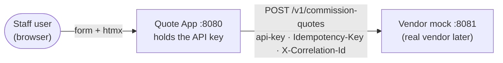

# Commission Quote App

A staff-facing web app that captures loan details and shows a commission quote from a vendor's Commission Quote API, plus a mock of that API (the real one isn't available yet).

- **Java 21 + Spring Boot 4**, server-rendered with **Thymeleaf + htmx**. About 40 lines of JavaScript in total.
- **The API key never reaches the browser.** The app calls the vendor server-side and fails fast at startup if the key is missing.
- **Failure is designed, not accidental:** timeouts, one bounded retry with an idempotency key (so no duplicate quotes), and a specific message for each kind of failure.
- **Money is `BigDecimal`** with explicit rounding, backed by a table of worked examples.
- **Accessible and responsive:** labelled inputs, managed focus, `role="alert"` errors, works at 320px and without JavaScript.

<!-- Phase 5: run every command in this file exactly as written, complete the tables, then delete this comment. -->

---

## Contents

- [Quick start](#quick-start)
- [Running the tests](#running-the-tests)
- [Trying the failure paths](#trying-the-failure-paths)
- [Configuration](#configuration)
- [How it works](#how-it-works)
- [Project structure](#project-structure)
- [How this meets the brief](#how-this-meets-the-brief)
- [Assumptions](#assumptions)
- [Trade-offs and next steps](#trade-offs-and-next-steps)
- [How I used AI](#how-i-used-ai)
- [Documentation](#documentation)

---

## Quick start

**Prerequisites:** JDK 21 (for example [Eclipse Temurin](https://adoptium.net/)). Nothing else — the Maven Wrapper downloads Maven. On Windows, use `mvnw.cmd` instead of `./mvnw`.

```bash
# 1. Start the vendor mock on http://localhost:8081
./mvnw -pl vendor-mock spring-boot:run -Dspring-boot.run.profiles=local

# 2. In a second terminal, start the app on http://localhost:8080
./mvnw -pl quote-app spring-boot:run -Dspring-boot.run.profiles=local

# 3. Open http://localhost:8080
```

The `local` profile gives both services the same obviously fake key (`local-dev-key-not-a-secret`), so there's nothing to configure. **Without the `local` profile, both services refuse to start until a key is provided** — see [Configuration](#configuration).

Try `500000` · `360` months · Medium → **$3,000.00** at **0.60%**.

---

## Running the tests

```bash
./mvnw verify                                   # everything (well under a minute)
./mvnw -pl vendor-mock verify                   # one module
./mvnw -pl quote-app test -Dtest=LoanDetailsParserTest   # one test class
```

The tests are deterministic: randomness, sleeping and the clock are injected, so nothing is flaky. CI runs `./mvnw -B verify` on every push ([`.github/workflows/ci.yml`](.github/workflows/ci.yml)).

---

## Trying the failure paths

The mock fails about 20% of the time and is slow about 5% of the time, by default. The app retries once, so you'll see an error about 1 time in 17. To force each path:

| To see… | Do this |
|---|---|
| Inline validation errors | Enter `12abc` as the amount, `12.5` as the term, and leave the risk band empty |
| A retryable vendor error | Restart the mock with `MOCK_CHAOS_FAILURE_RATE=1` |
| A timeout | Restart the mock with `MOCK_CHAOS_SLOW_RATE=1` (the error appears after about 4 seconds) |
| Vendor unavailable | Stop the mock |
| No randomness at all | Restart the mock with `MOCK_CHAOS_ENABLED=false` |
| Raw vendor behaviour, no retry | Restart the app with `VENDOR_MAX_RETRIES=0` |

```bash
# Example: a vendor that always fails
MOCK_CHAOS_FAILURE_RATE=1 ./mvnw -pl vendor-mock spring-boot:run -Dspring-boot.run.profiles=local
```

Every error shows a **Reference**: the correlation id, which appears on the matching log lines in both services.

### Calling the mock API directly

```bash
# No api-key → 401 Problem Details
curl -i -X POST http://localhost:8081/v1/commission-quotes \
  -H 'Content-Type: application/json' \
  -d '{"loanAmount":500000,"loanTermInMonths":360,"riskBand":"MEDIUM"}'

# Valid key → 200 (X-Mock-Scenario: ok skips the random failures)
curl -i -X POST http://localhost:8081/v1/commission-quotes \
  -H 'Content-Type: application/json' \
  -H 'api-key: local-dev-key-not-a-secret' \
  -H 'Idempotency-Key: 6f1c3c4e-1111-4a2b-9c3d-123456789abc' \
  -H 'X-Mock-Scenario: ok' \
  -d '{"loanAmount":500000,"loanTermInMonths":360,"riskBand":"MEDIUM"}'
# → {"quoteId":"…","commissionRate":0.0060,"totalCommission":3000.00}
# Send it again with the same Idempotency-Key → same quoteId, plus "Idempotent-Replayed: true"
```

---

## Configuration

Every variable is listed, with safe placeholders, in [`.env.example`](.env.example). The full table is in [ARCHITECTURE §12](docs/ARCHITECTURE.md#12-configuration).

| Service | Variable | Default | Purpose |
|---|---|---|---|
| quote-app | `VENDOR_API_KEY` | **required** (`local` profile provides one) | Key sent as the `api-key` header |
| quote-app | `VENDOR_BASE_URL` | `http://localhost:8081` | Where the vendor lives |
| quote-app | `VENDOR_READ_TIMEOUT` | `2s` | Per-attempt timeout |
| quote-app | `VENDOR_MAX_RETRIES` | `1` | Retries after the first attempt |
| vendor-mock | `MOCK_API_KEYS` | **required** (`local` profile provides one) | Accepted keys, comma-separated (supports rotation) |
| vendor-mock | `MOCK_CHAOS_ENABLED` | `true` | Turn random failures on or off |
| vendor-mock | `MOCK_CHAOS_FAILURE_RATE` | `0.2` | Probability of a 500/503 |
| vendor-mock | `MOCK_CHAOS_SLOW_RATE` | `0.05` | Probability of a response slower than the app's timeout |

---

## How it works



1. The browser posts the form to the **Quote App**. htmx swaps in the result without a page reload; without JavaScript, the same form does a normal full-page post.
2. `LoanDetailsParser` turns raw input into a valid `LoanDetails`, or returns specific field errors (`250,000` is fine; `1e6` isn't).
3. `HttpCommissionQuoteGateway` calls the vendor with the key, a 2s timeout, and one retry for 5xx/timeouts/connection failures. Every attempt reuses the same idempotency key.
4. Failures are a **sealed** hierarchy (`VendorUnavailable`, `VendorTimeout`, `VendorMisconfigured`, `VendorRejected`, `VendorBadResponse`), mapped in one place to an HTTP status, a message, and whether "Try again" is offered.
5. The **vendor mock** checks the key (constant time), validates strictly, injects random failures and delays, prices the quote, and replays stored responses for repeated idempotency keys.

The design, the rules and 12 short ADRs are in [`docs/ARCHITECTURE.md`](docs/ARCHITECTURE.md).

---

## Project structure

```text
commission-quote-app/
├── contracts/commission-quote-api.yaml   # OpenAPI 3.1 — the only thing the modules share
├── vendor-mock/                          # Mock vendor API (:8081)
│   └── src/main/java/…/vendormock/
│       ├── api/          controller, request/response records, Problem Details advice
│       ├── pricing/      CommissionCalculator (pure), RiskBand
│       ├── security/     ApiKeyFilter
│       ├── chaos/        ChaosFilter, ChaosProperties, Sleeper
│       ├── idempotency/  IdempotencyStore
│       └── web/          CorrelationIdFilter
├── quote-app/                            # Staff web app (:8080)
│   └── src/main/java/…/quoteapp/
│       ├── quote/        domain + application: LoanDetails, QuoteService, gateway port, QuoteFailure
│       ├── vendor/       HTTP adapter: HttpCommissionQuoteGateway, client config and properties
│       └── web/          controller, LoanDetailsParser, QuoteFailureHandler, filters
│   └── src/main/resources/  templates/index.html, static/css/app.css, static/js/app.js
├── docs/                 ARCHITECTURE.md, PLAN.md, ai/BUILD_PROMPT.md
├── AGENTS.md, CLAUDE.md  # Conventions and commands for AI assistants
└── .github/workflows/ci.yml
```

---

## How this meets the brief

<!-- Phase 5: replace the planned names below with the real file and test names, then delete this comment. -->

| ID | Requirement | Where | Evidence |
|---|---|---|---|
| R1 | Form for `loanAmount`, `loanTermInMonths`, `riskBand` | `templates/index.html`, `QuoteForm` | `QuoteControllerTest` |
| R2 | "Generate Quote" button | `templates/index.html` | `QuoteControllerTest` |
| R3 | Display the quote on success | `quotePanel` fragment | `QuoteControllerTest` |
| R4 | Loading states and error messages | htmx indicator, `QuoteFailureHandler`, `app.js` | `QuoteControllerTest`, manual smoke test |
| R5 | Mock API honouring the contract | `vendor-mock`, `contracts/…yaml` | `QuoteRequestValidationTest`, `CommissionCalculatorTest` |
| R6 | `api-key` required; invalid keys rejected | `ApiKeyFilter`, `HttpCommissionQuoteGateway` | `ApiKeyFilterTest`, `HttpCommissionQuoteGatewayTest` |
| R7 | Random errors | `ChaosFilter` | `ChaosFilterTest` |
| R8 | Core tests | both modules | `./mvnw verify` |
| R9 | Invalid numbers; timeouts and errors | `LoanDetailsParser`, gateway retry/timeouts | `LoanDetailsParserTest`, `HttpCommissionQuoteGatewayTest` |
| R10 | Readable structure | package-by-feature, ports and adapters | ARCHITECTURE §3 |
| R11 | Run and test instructions | this README | — |
| R12 | AI usage section | [below](#how-i-used-ai) | — |
| N1 | Clean, accessible, responsive UI | `app.css`, ARCHITECTURE §10.4 | smoke test step 10 |

---

## Assumptions

The brief fixes the field names and the `api-key` header. Everything else below is an assumption to confirm with the vendor. Details are in [ARCHITECTURE §5](docs/ARCHITECTURE.md#5-contract).

- Amounts are **AUD** in dollars and cents; `loanAmount` 1,000–5,000,000; term 12–360 whole months.
- `riskBand` is `LOW`, `MEDIUM` or `HIGH`.
- `commissionRate` is a **fraction** (`0.0060` = 0.60%).
- The mock's commission formula is illustrative. **The app never calculates commission itself.**
- `Idempotency-Key` and `X-Correlation-Id` are optional extensions; the app still works if the vendor ignores them.

---

## Trade-offs and next steps

- **No circuit breaker or rate-limit handling yet.** Tuning them needs the real vendor's SLA and limits; one bounded retry is the right amount for now.
- **No staff login, hence no CSRF tokens.** There are no sessions or cookies to abuse today; SSO plus CSRF comes together (ADR-009).
- **No persistence.** Quotes aren't stored; `QuoteService` is where history or audit would go.
- **When the real vendor arrives:** change `VENDOR_BASE_URL`, source the key from a secrets manager, confirm the assumptions, and add contract tests. No code change needed for the switch itself ([ARCHITECTURE §15](docs/ARCHITECTURE.md#15-out-of-scope-and-the-path-to-production)).

---

## How I used AI

<!-- Rahul: answer the comments below from your own experience, keep every line specific and true, then delete all of these Rahul comments. -->

- **Planning — Claude (claude.ai).** I chose the stack: Java 21 + Spring Boot because it's my strongest, and server-rendered htmx so the UI stays in Java and templates. Claude reviewed the brief with me and drafted `docs/ARCHITECTURE.md`, `docs/PLAN.md`, the OpenAPI contract and the build prompt ([`docs/ai/BUILD_PROMPT.md`](docs/ai/BUILD_PROMPT.md), committed for transparency).
  <!-- Rahul: what you changed in those drafts before building. -->
- **Implementation — Claude Code.** It generated the code, tests and configuration phase by phase from the build prompt. I reviewed each phase at a gate before letting it continue.
  <!-- Rahul: what you rejected, rewrote or simplified, and why. -->
- **Verification — me.**
  <!-- Rahul: what you checked yourself (e.g. read every file, re-derived the worked commission examples, ran the smoke test, keyboard-only pass). -->
- **Ownership.** I can explain every file. Where the build departed from the plan, the reason is in the Decision log at the end of `docs/ARCHITECTURE.md`.

---

## Documentation

| Document | What it's for |
|---|---|
| [`docs/ARCHITECTURE.md`](docs/ARCHITECTURE.md) | Design, business rules, error model, security, config, testing strategy, ADRs |
| [`docs/PLAN.md`](docs/PLAN.md) | Phased delivery plan, acceptance criteria, manual smoke test |
| [`contracts/commission-quote-api.yaml`](contracts/commission-quote-api.yaml) | Vendor API contract (OpenAPI 3.1) |
| [`docs/ai/BUILD_PROMPT.md`](docs/ai/BUILD_PROMPT.md) | The prompt used to build this with Claude Code |
| [`AGENTS.md`](AGENTS.md) | Conventions and commands for AI assistants working in this repo |
