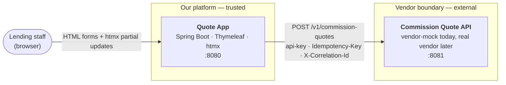
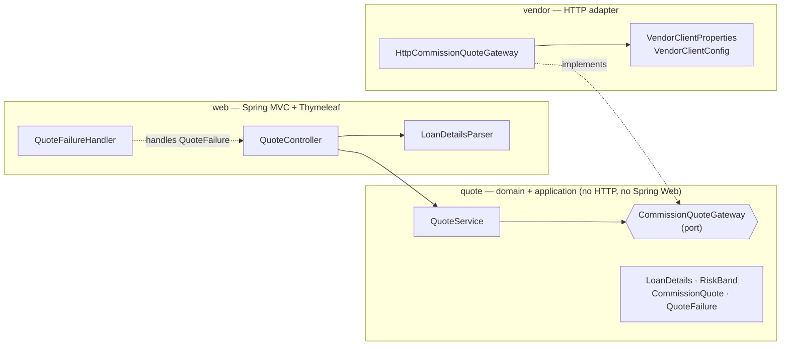
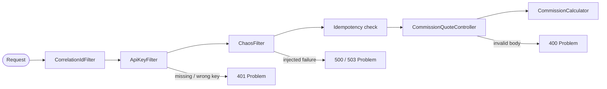
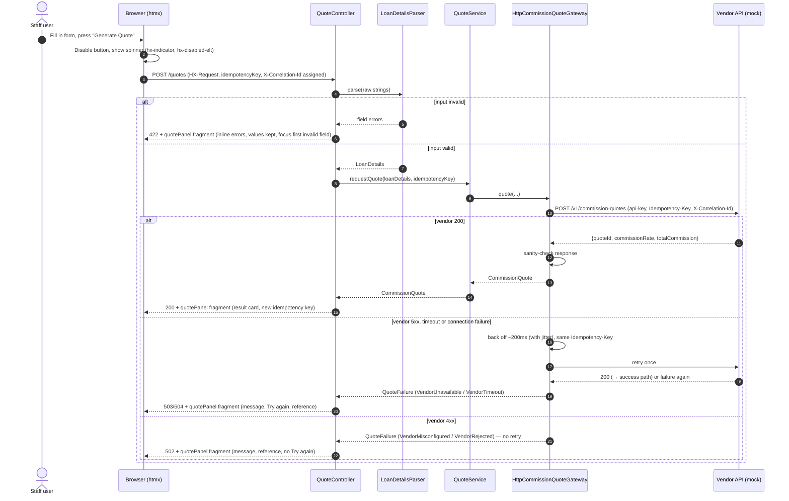

# Architecture — Commission Quote App

| | |
|---|---|
| **Status** | Design baseline. Updated to as-built at the end of Phase 5 (see §17 Decision log) |
| **Owner** | Rahul |
| **Contract** | [`contracts/commission-quote-api.yaml`](../contracts/commission-quote-api.yaml) (OpenAPI 3.1) |
| **Plan** | [`docs/PLAN.md`](PLAN.md) |
| **Stack** | Java 21 · Spring Boot 4.x · Thymeleaf · htmx 2.0 · Maven · JUnit 5 · WireMock |

---

## 1. Purpose and scope

Lending staff need commission quotes for loan applications. Quotes come from an external vendor's **Commission Quote API**. That API isn't built yet, but its contract and authentication are agreed. This repository contains two deployables:

- **Quote App** — a staff-facing web app that captures loan details, requests a quote, and presents the result or the failure clearly.
- **Vendor mock** — a stand-in that implements the agreed contract, including `api-key` authentication and random failures, so the app can be built and tested now and pointed at the real vendor later **by configuration alone**.

### Quality goals, in priority order

1. **Correct.** Money and validation are right at every boundary.
2. **Honest under failure.** Every failure has a defined outcome the user can understand. Nothing hangs; nothing creates a duplicate quote.
3. **Secure by default.** The vendor API key never leaves the server.
4. **Readable and changeable.** A reader can follow one request end to end in a few minutes and change it safely.
5. **Accessible.** Usable with keyboard and screen reader, and on a phone.

### Non-goals

Staff authentication, persistence, multiple vendors and cloud deployment are out of scope. §15 describes how each would be added.

---

## 2. System context



**The browser never talks to the vendor.** The Quote App is a backend-for-frontend: it holds the API key, applies timeouts and retries, and turns vendor failures into messages people can act on (ADR-001).

---

## 3. Building blocks

| Module | Responsibility | Port | Depends on |
|---|---|---|---|
| `quote-app` | UI, input parsing, orchestration, vendor client, failure mapping | 8080 | the vendor contract only |
| `vendor-mock` | Implements the contract: auth, validation, pricing, chaos, idempotency | 8081 | nothing |
| `contracts/` | OpenAPI 3.1 contract — the **only** artefact the modules share | — | — |

The modules share **no code**. In production the vendor is someone else's system, so sharing DTOs with it would be a fiction that hides contract drift (ADR-002).

### 3.1 Quote App — internal structure (ports and adapters, kept light)



Dependencies point inward. `web` and `vendor` depend on `quote`; `quote` depends on neither. Swapping the mock for the real vendor, or adding a second vendor, changes only the `vendor` package and configuration.

`QuoteService` is thin today. It is the seam where the obvious next requirements land — quote history, audit logging, comparing vendors — so the controller stays about HTTP.

### 3.2 Vendor mock — request pipeline



**Why this order:** authentication is deterministic and comes first, so a request without a key always gets a 401, never a random 503. Chaos applies only to authenticated traffic, which is how a real flaky vendor behaves.

---

## 4. Runtime view — one quote request



---

## 5. Contract

The full contract is [`contracts/commission-quote-api.yaml`](../contracts/commission-quote-api.yaml).

```http
POST /v1/commission-quotes HTTP/1.1
Content-Type: application/json
api-key: <secret>
Idempotency-Key: 6f1c3c4e-1111-4a2b-9c3d-123456789abc     (optional extension)
X-Correlation-Id: 9b2d7f0c-3c1e-4c55-8d0e-2a7c1f6b9e10    (optional extension)

{ "loanAmount": 500000.00, "loanTermInMonths": 360, "riskBand": "MEDIUM" }
```

```http
HTTP/1.1 200 OK
Content-Type: application/json
X-Correlation-Id: 9b2d7f0c-3c1e-4c55-8d0e-2a7c1f6b9e10

{ "quoteId": "3f6c2a9e-8d1b-4c7e-9a52-0b6f1d2e4a77", "commissionRate": 0.0060, "totalCommission": 3000.00 }
```

### Assumptions to confirm with the vendor

| # | Assumption | Why it matters |
|---|---|---|
| A1 | Currency is AUD; `loanAmount` and `totalCommission` are dollars with cents, sent as JSON numbers | Formatting and rounding |
| A2 | `riskBand` ∈ `LOW`, `MEDIUM`, `HIGH` (case-sensitive) | The contract names the field, not its values |
| A3 | `commissionRate` is a decimal fraction (`0.0060` = 0.60%) | Off-by-100 display bugs |
| A4 | `loanAmount` 1,000–5,000,000; `loanTermInMonths` 12–360 | Validation bounds (both sides) |
| A5 | Success is `200 OK`, not `201` — a quote is computed, not a resource we can GET | Client status handling |
| A6 | `Idempotency-Key` and `X-Correlation-Id` are optional extensions | The app works if the vendor ignores them; we only lose dedupe and tracing |
| A7 | The `api-key` is a static shared secret per environment | Secret storage and rotation |
| A8 | Commission rules belong to the vendor. **The app never calculates commission** | The mock's rules (§6.2) are illustrative only |

---

## 6. Business rules

### 6.1 Input rules (Quote App — `LoanDetailsParser`)

The form posts raw strings. The parser is the single authority for turning them into a valid `LoanDetails` or field errors. Browser constraints are hints only (ADR-010).

| Field | Accepted | Rejected → message shown |
|---|---|---|
| **Loan amount** | Digits with an optional leading `$`, optional thousands commas in groups of three, optional `.` with 1–2 decimals; surrounding whitespace trimmed. Range **1,000.00–5,000,000.00**. Examples: `250000`, `250,000`, `$250,000.50`, `" 1000 "` | Blank → *"Enter a loan amount."*<br/>Not a plain number — `abc`, `12abc`, `1e6`, `NaN`, `Infinity`, `1,00,000`, `12,34`, more than 20 characters → *"Enter the loan amount as a number, for example 250000 or 250,000."*<br/>More than 2 decimal places, e.g. `1000.001` → *"Loan amount can have at most 2 decimal places."*<br/>Out of range, including `0` and negatives → *"Enter a loan amount between $1,000 and $5,000,000."* |
| **Loan term (months)** | Whole number, trimmed, **12–360** | Blank → *"Enter a loan term in months."*<br/>Not a whole number — `12.5`, `12.0`, `abc`, `-12`, more than 3 digits → *"Enter the loan term as a whole number of months."*<br/>Out of range → *"Enter a loan term between 12 and 360 months."* |
| **Risk band** | `LOW`, `MEDIUM`, `HIGH` (radio values) | Missing or tampered value → *"Select a risk band."* |

**Hint text:** "Between $1,000 and $5,000,000" · "Whole months, 12 to 360 (1 to 30 years)".

**Traps the parser must close:** `new BigDecimal("1e6")` succeeds, so scientific notation needs an explicit check. Stripping every comma would silently turn the European `12,34` into `1234`, so commas are only valid as thousands separators. Unknown enum values must become a field error, not a 500.

### 6.2 Commission rules (vendor mock only — illustrative)

Implemented in `CommissionCalculator`, a pure class with no Spring dependencies.

1. Base rate in basis points by band: **LOW 65 · MEDIUM 55 · HIGH 40**.
2. Term uplift: **+5 bps** when `loanTermInMonths >= 240`.
3. `commissionRate = bps / 10,000`, at scale 4.
4. `totalCommission = loanAmount × commissionRate`, rounded **HALF_UP** to 2 dp, **capped at 25,000.00**.

| loanAmount | Term | Band | bps | commissionRate | totalCommission | What it proves |
|---:|---:|---|---:|---:|---:|---|
| 500,000.00 | 360 | MEDIUM | 60 | 0.0060 | 3,000.00 | Term uplift applies |
| 123,456.78 | 120 | MEDIUM | 55 | 0.0055 | 679.01 | Rounds down (679.01229) |
| 1,090.00 | 12 | LOW | 65 | 0.0065 | **7.09** | Exact half (7.085) → HALF_UP; HALF_EVEN would give 7.08 |
| 5,000,000.00 | 300 | LOW | 70 | 0.0070 | 25,000.00 | Cap (uncapped 35,000.00) |
| 1,000.00 | 12 | HIGH | 40 | 0.0040 | 4.00 | Minimum amount |
| 250,000.00 | 239 | HIGH | 40 | 0.0040 | 1,000.00 | Just below the uplift boundary |
| 250,000.00 | 240 | HIGH | 45 | 0.0045 | 1,125.00 | On the uplift boundary |

These rows are the `CommissionCalculatorTest` table.

### 6.3 Money handling

- `BigDecimal` end to end. **No `double` anywhere money is involved** (ADR-004).
- Rates are held as integer basis points and converted once, so the rate itself never carries floating-point error.
- Every rounding call names its `RoundingMode`. There are no implicit scale changes.
- Jackson reads JSON numbers into `BigDecimal` directly (no `double` round trip).
- Display (app only): rate as a percentage to 2 dp (`0.60%`); amounts via `NumberFormat` for `en-AU` currency (`$3,000.00`).

---

## 7. Error model

### 7.1 Vendor errors — RFC 9457 Problem Details

Every vendor error is `application/problem+json` with two extension members: `code` (stable and machine-readable) and `correlationId`.

| Status | `code` | When |
|---|---|---|
| 400 | `VALIDATION_FAILED` | Body is valid JSON but breaks a rule; includes `errors[{field, message}]` |
| 400 | `MALFORMED_REQUEST` | Body isn't parseable JSON, or a value has the wrong type (`"12"` for an integer, `12.5` for the term) |
| 401 | `UNAUTHORIZED` | `api-key` missing, blank or wrong — one response for all three |
| 415 | `UNSUPPORTED_MEDIA_TYPE` | Content-Type isn't JSON |
| 422 | `IDEMPOTENCY_KEY_REUSED` | Same `Idempotency-Key`, different body |
| 500 | `SIMULATED_INTERNAL_ERROR` | Chaos |
| 503 | `SIMULATED_UNAVAILABLE` | Chaos |
| 500 | `INTERNAL_ERROR` | Anything unexpected (should never happen) |

```json
{
  "type": "about:blank",
  "title": "Bad Request",
  "status": 400,
  "detail": "Request validation failed.",
  "code": "VALIDATION_FAILED",
  "correlationId": "9b2d7f0c-3c1e-4c55-8d0e-2a7c1f6b9e10",
  "errors": [{ "field": "loanTermInMonths", "message": "must be a whole number between 12 and 360" }]
}
```

### 7.2 Quote App — failure taxonomy

`QuoteFailure` is a **sealed** exception hierarchy. `QuoteFailureHandler` maps it in one place with a pattern-matching `switch`, so the compiler flags any new subtype that isn't handled (ADR-006).

| Failure | Raised when | App retries? | HTTP to browser | Message shown | "Try again"? |
|---|---|---|---|---|---|
| `VendorUnavailable` | Vendor 500/502/503/504, or connection refused/reset, after retries | Yes (bounded) | 503 | The quote service is temporarily unavailable. Your details are still here — please try again. | Yes |
| `VendorTimeout` | Read timeout on the final attempt | Yes (bounded) | 504 | The quote service took too long to respond. Please try again. | Yes |
| `VendorMisconfigured` | Vendor 401/403 — our key or config is wrong | No | 502 | We can't get a quote right now because of a configuration problem on our side. Please contact support with the reference below. | No |
| `VendorRejected` | Any other vendor 4xx (e.g. 400, 422) | No | 502 | The quote service couldn't process these loan details. Please check them, or contact support with the reference below. | No |
| `VendorBadResponse` | 2xx with malformed JSON, a missing field, `commissionRate` outside [0, 1], or a negative `totalCommission` | No | 502 | We received an unexpected response from the quote service. Please try again later. | Yes |
| Unexpected exception | A bug | No | 500 | Something went wrong on our side. Please try again. | Yes |

Every server-rendered error shows **"Reference: {correlationId}"**, which support can match to the logs in both services.

**Why 401 from the vendor becomes 502, not 401:** the user is not unauthenticated — *we* are. Passing a 401 through would tell the browser the wrong thing.

### 7.3 UI states

| State | Trigger | What the user sees | Focus moves to |
|---|---|---|---|
| Idle | First load or after success | Empty form (or previous values after success) and a fresh idempotency key | — |
| Loading | Request in flight | Button disabled, reads "Generating…", `aria-busy="true"`, spinner (static when `prefers-reduced-motion`) | stays |
| Success | 200 | Result card: total commission (AUD), rate (%), quote ID, input echo, "Generated at" (Sydney time) | Result heading |
| Validation error | 422 | Inline message under each bad field, `aria-invalid`, values kept | First invalid field |
| Upstream error | 502/503/504/500 | `role="alert"` box: message, reference, optional Try again | Error alert |
| Client network error | `htmx:sendError` | "We couldn't reach the server. Check your connection and try again." | Error alert |
| Client timeout | `htmx:timeout` (10s) | "This is taking longer than expected. Please try again." | Error alert |

---

## 8. Resilience

| Concern | Decision |
|---|---|
| Connect timeout | 1s (`vendor.connect-timeout`) |
| Read timeout | 2s per attempt (`vendor.read-timeout`) |
| Retries | `max-retries = 1`, so at most 2 attempts. Exponential backoff from 200ms with jitter, using Spring Framework 7's `RetryTemplate` |
| Retry on | 500, 502, 503, 504, connection failures, read timeouts |
| Never retry | Any 4xx — retrying won't fix a bad key or a bad body |
| Duplicate protection | The same `Idempotency-Key` is reused on every attempt and on the user's "Try again" (ADR-005) |
| Server-side budget | Worst case is about 2 × 2s + 0.3s backoff ≈ **4.3s** (≈ 6.3s if connects also hang) |
| Client budget | `htmx.config.timeout = 10s`, above the server's worst case, so the server always answers first |

**Why retrying a POST is safe here:** if attempt 1 timed out after the vendor had already created a quote, attempt 2 carries the same `Idempotency-Key`, and the vendor returns the stored quote instead of creating a second one. The same mechanism covers double-clicks and "Try again".

**Expected failures with default chaos:** each attempt fails with probability ≈ 0.2 + 0.8 × 0.05 = 0.24, so a user sees an error after two attempts about 0.24² ≈ **6%** of the time — often enough to exercise the error UI, rare enough to use the app. Set `MOCK_CHAOS_FAILURE_RATE=1` to force failures in a demo.

**Deliberately not yet:** circuit breaker, bulkhead, rate limiting, and handling `429 Retry-After`. They are worth adding once the real vendor's SLAs and limits are known (§15). Adding them now would mean tuning against made-up numbers.

---

## 9. Security

### 9.1 API key custody

1. Supplied as `VENDOR_API_KEY` (env) and bound to `@Validated @ConfigurationProperties` with `@NotBlank`. **The app refuses to start without it** outside the `local` profile.
2. `toString()` on the properties type is redacted, and the key is never logged or rendered.
3. It is added to outbound requests inside the vendor adapter only.
4. A test asserts the key never appears in any rendered response body.
5. The `local` profile in each module holds the same obviously fake key, `local-dev-key-not-a-secret`, so the app runs with zero config. No other profile has a default.

### 9.2 Vendor mock auth

- Reads the `api-key` header (the exact name in the brief).
- Accepts a **set** of keys from config, which allows rotation with an overlap window.
- Compares in constant time: `MessageDigest.isEqual` on SHA-256 digests, so key length doesn't leak through timing either.
- Missing, blank and wrong keys get the same 401 body.
- `/actuator/health` is open.

### 9.3 Threats and mitigations

| Threat | Mitigation |
|---|---|
| Key exposed to the browser or a JS bundle | Server-side BFF; no front-end build; test asserts the key is absent from responses |
| Key in logs | Redacted `toString`; headers are never logged; reviewed in Phase 3 |
| Key guessing or timing attack on the mock | Constant-time comparison; uniform 401 |
| XSS via echoed input | Thymeleaf `th:text` escaping everywhere (never `th:utext`); CSP `default-src 'self'` |
| Clickjacking | `frame-ancestors 'none'` |
| Duplicate quotes from double-clicks or retries | `hx-disabled-elt` plus `Idempotency-Key` |
| Thread exhaustion from a slow vendor | Timeouts and bounded retry; virtual threads in the mock |
| Tampered form values (e.g. `riskBand=EXTREME`) | Server-side parsing to an enum; field error, not a 500 |
| Oversized input | 20-character limit on amount, 3 digits on term; small form-post size limit |

### 9.4 Headers

`Content-Security-Policy: default-src 'self'; script-src 'self'; style-src 'self'; form-action 'self'; frame-ancestors 'none'; base-uri 'self'`, `X-Content-Type-Options: nosniff`, `Referrer-Policy: no-referrer`.

To stay within that CSP, the page has no inline scripts and no `hx-on` attributes, and sets `htmx.config.allowEval = false` and `htmx.config.includeIndicatorStyles = false`. Otherwise htmx injects an inline `<style>`, which `style-src 'self'` blocks.

### 9.5 CSRF

The app has no login, session or cookies, so there is no ambient authority for a cross-site request to borrow. When staff SSO arrives, Spring Security's CSRF protection comes with it, and htmx sends the token via `hx-headers` (ADR-009).

---

## 10. UI architecture

**Server-rendered Thymeleaf with htmx** (ADR-003). The server owns validation, formatting and every message, so there is one source of truth and almost no JavaScript to own.

### 10.1 Page and fragments (`templates/index.html`)

| Fragment | Contents | Returned when |
|---|---|---|
| (full page) | Layout, `htmx-config` meta tag, CSS, scripts, `quotePanel` | `GET /`, or a non-htmx `POST /quotes` |
| `quotePanel` | The form (values, errors, hidden idempotency key) plus the outcome area (result, error, or empty) | Any htmx `POST /quotes` |

Returning one fragment for every outcome keeps the swap logic trivial: target `#quote-panel`, swap `outerHTML`.

### 10.2 htmx wiring

| Attribute / config | Purpose |
|---|---|
| `hx-post="/quotes"` on the `<form>` (with `action`/`method` set for no-JS fallback) | Submit asynchronously |
| `hx-target="#quote-panel"` `hx-swap="outerHTML"` | Replace the whole panel |
| `hx-indicator="#quote-panel"` | Adds `htmx-request` → CSS shows spinner and "Generating…" |
| `hx-disabled-elt="find button[type=submit]"` | Prevents double submit |
| `<meta name="htmx-config">` → `responseHandling` | htmx 2 **does not swap 4xx/5xx by default**. Configure: 204 no swap; 2xx swap; 422 swap; 500/502/503/504 swap (flagged as error); everything else no swap + error event |
| `timeout: 10000`, `allowEval: false`, `includeIndicatorStyles: false` | Budget and CSP (see §8, §9.4) |
| `static/js/app.js` (~40 lines) | Handles `htmx:sendError`, `htmx:timeout`, and unswapped `htmx:responseError` by writing a static message into the outcome area |

**Progressive enhancement:** without JavaScript, the same form posts normally and the server returns the full page. The controller picks between them based on the `HX-Request` header.

### 10.3 Idempotency key lifecycle

| Event | Key in the rendered form |
|---|---|
| Fresh form (`GET /`) | New UUID |
| Validation error | Same key (the vendor was never called) |
| Vendor failure | Same key — "Try again" must not create a duplicate quote |
| Success | New UUID — the next submission is a new quote, even with identical inputs |

### 10.4 Accessibility checklist

- Every input has a `<label>`; hint and error are linked with `aria-describedby`; bad fields carry `aria-invalid="true"`.
- Risk band is a radio group in a `<fieldset>` with a `<legend>` — three visible options, one tap each.
- Text inputs use `inputmode="decimal"` / `inputmode="numeric"` for mobile keyboards, not `type="number"` (ADR-010).
- After each swap, focus moves to the first invalid field, the error alert, or the result heading (`tabindex="-1"` plus `autofocus`, which htmx honours on swapped content).
- Error box has `role="alert"`. Focus styles are visible. Text meets WCAG AA contrast. The spinner respects `prefers-reduced-motion`.
- Single column, `max-width: 40rem`, usable at 320px wide with no horizontal scroll.

### 10.5 Visual design

One stylesheet built on CSS custom properties: a neutral palette with one accent, a system font stack, a 4px spacing scale, and a card with a subtle border. A dark theme via `prefers-color-scheme` is optional. Restraint over decoration.

---

## 11. Observability

- **Correlation ID.** `CorrelationIdFilter` in both modules reuses an incoming `X-Correlation-Id` if it matches `^[A-Za-z0-9-]{1,64}$`, otherwise generates a UUID. It goes into the MDC (and so every log line) and is echoed on the response. The app forwards it to the vendor and shows it to users as "Reference".
- **Logs** (key=value, one line per outcome). Loan amounts aren't logged: they're commercially sensitive and add nothing to diagnosis.

  ```text
  WARN  [corr=9b2d7f0c…] vendor.attempt attempt=1 status=503 durationMs=48 retrying=true
  INFO  [corr=9b2d7f0c…] quote.outcome result=SUCCESS band=MEDIUM termMonths=360 attempts=2 durationMs=301 quoteId=3f6c2a9e…
  ```
- **Health:** `/actuator/health` on both services; no other actuator endpoints are exposed.

---

## 12. Configuration

Documented env vars are mapped **explicitly** with `${ENV_VAR:default}` placeholders. Spring's relaxed binding would otherwise expect names like `MOCK_CHAOS_FAILURERATE`.

### quote-app

| Property | Env var | Default | Notes |
|---|---|---|---|
| `server.port` | `SERVER_PORT` | `8080` | |
| `vendor.base-url` | `VENDOR_BASE_URL` | `http://localhost:8081` | Point at the real vendor later |
| `vendor.api-key` | `VENDOR_API_KEY` | **none — required** | `local` profile: `local-dev-key-not-a-secret` |
| `vendor.connect-timeout` | `VENDOR_CONNECT_TIMEOUT` | `1s` | |
| `vendor.read-timeout` | `VENDOR_READ_TIMEOUT` | `2s` | |
| `vendor.max-retries` | `VENDOR_MAX_RETRIES` | `1` | `0` disables retry, to see raw vendor behaviour |
| `vendor.retry-initial-backoff` | `VENDOR_RETRY_BACKOFF` | `200ms` | Doubles per retry, with jitter |

### vendor-mock

| Property | Env var | Default | Notes |
|---|---|---|---|
| `server.port` | `SERVER_PORT` | `8081` | |
| `mock.api-keys` | `MOCK_API_KEYS` | **none — required** | Comma-separated, to allow rotation. `local`: `local-dev-key-not-a-secret` |
| `mock.chaos.enabled` | `MOCK_CHAOS_ENABLED` | `true` | |
| `mock.chaos.failure-rate` | `MOCK_CHAOS_FAILURE_RATE` | `0.2` | 0–1 |
| `mock.chaos.slow-rate` | `MOCK_CHAOS_SLOW_RATE` | `0.05` | 0–1; failure-rate + slow-rate ≤ 1 |
| `mock.chaos.slow-delay` | `MOCK_CHAOS_SLOW_DELAY` | `5s` | Longer than the app's read timeout |
| `mock.chaos.latency-min` / `latency-max` | — | `50ms` / `400ms` | Normal jitter |
| `mock.chaos.scenario-header-enabled` | `MOCK_CHAOS_SCENARIO_HEADER` | `true` | Honours `X-Mock-Scenario` |
| `mock.idempotency.ttl` | — | `10m` | |
| `mock.idempotency.max-entries` | — | `10000` | Bounded memory |

Both modules validate their properties at startup (rates in range, min ≤ max, durations positive) and fail fast with a clear message.

---

## 13. Testing strategy

| Layer | Scope | Tools | Main cases |
|---|---|---|---|
| Unit | `CommissionCalculator`, `LoanDetailsParser` | JUnit 5, AssertJ, `@ParameterizedTest` | The §6.1 and §6.2 tables, row by row |
| Slice | Mock filters and controller; app controller and templates | `@WebMvcTest` / MockMvc, `@MockitoBean` | Auth matrix, validation matrix, chaos, idempotency, every UI state, htmx vs full page, key never rendered |
| HTTP integration | `HttpCommissionQuoteGateway` against a real HTTP server | WireMock | Headers sent, retry then success with the **same** idempotency key, retry exhausted, timeout, 401/400 not retried, bad response, connection refused |
| Context | App startup | `@SpringBootTest` | Fails without `VENDOR_API_KEY`; starts with it |
| Manual smoke | Both services running | Browser + curl | PLAN.md manual smoke test |

**Determinism rules:** randomness via an injected `RandomGenerator`; sleeping via an injected `Sleeper`; time via an injected `Clock`. No test sleeps longer than 100ms. Timeout tests use a ~250ms read timeout against a ~1s WireMock delay. Only localhost network calls. `./mvnw verify` should take well under a minute.

**Not automated (and why):** browser-level end-to-end tests and visual checks. They are stretch item S3 (Playwright); the MockMvc tests already cover every server-rendered state.

---

## 14. Code tour (planned paths — corrected to as-built in Phase 5)

Follow one request:

1. `quote-app/.../web/QuoteController.java` — `GET /` and `POST /quotes`; fragment or full page.
2. `quote-app/.../web/LoanDetailsParser.java` — raw strings → `LoanDetails` or field errors (§6.1).
3. `quote-app/.../quote/QuoteService.java` — the application seam.
4. `quote-app/.../vendor/HttpCommissionQuoteGateway.java` — headers, timeouts, `RetryTemplate`, error classification, response checks.
5. `quote-app/.../quote/QuoteFailure.java` — the sealed taxonomy.
6. `quote-app/.../web/QuoteFailureHandler.java` — failure → status, message, retry flag.
7. `quote-app/src/main/resources/templates/index.html` — the page and the `quotePanel` fragment.
8. `vendor-mock/.../security/ApiKeyFilter.java` → `chaos/ChaosFilter.java` → `api/CommissionQuoteController.java` → `pricing/CommissionCalculator.java`.
9. Tests mirror each of the above.

---

## 15. Out of scope, and the path to production

When the real vendor is ready:

1. Point `VENDOR_BASE_URL` at the vendor sandbox and load `VENDOR_API_KEY` from a secrets manager. **No code change.**
2. Confirm assumptions A1–A8 (§5); update the contract file and the Decision log.
3. Add contract tests against the vendor sandbox (stretch item S2 starts this).
4. Tune timeouts to the vendor's SLA; add a circuit breaker and bulkhead (e.g. Resilience4j) and honour `429 Retry-After`.
5. Add staff SSO (OIDC) with CSRF protection, plus an audit record per quote (who, when, inputs, `quoteId`) for compliance.
6. Persist quotes if history or expiry is needed.
7. Add Micrometer metrics (vendor latency histogram, failures by type, retry count) with alerts.
8. Keep `vendor-mock` as a test double for CI and local development, or delete it.

---

## 16. Architecture decision records

> Format: **Context → Decision → Consequences.** Each is short on purpose.

**ADR-001 — The server holds the API key (backend-for-frontend).**
The vendor demands a secret header. → The browser calls only the Quote App, which adds the key server-side. → The key can't leak through the browser; the app gets one place to apply timeouts, retries and error mapping. Cost: one extra hop.

**ADR-002 — The mock is a separate deployable that shares no code; OpenAPI is the contract.**
The vendor is external in reality. → `vendor-mock` is its own Spring Boot app; the only shared artefact is `contracts/commission-quote-api.yaml`. The small `RiskBand` enum is duplicated on purpose. → Contract drift shows up as test failures rather than hiding behind a shared class; the mock can be deleted without touching the app.

**ADR-003 — Server-rendered Thymeleaf + htmx instead of a SPA.**
A one-screen form with server-owned validation and formatting; the team owning it is Java-first. → Thymeleaf fragments swapped by htmx; about 40 lines of JavaScript in total. → One language, one source of validation truth, no Node toolchain, CSP-friendly, works without JS. Cost: richer client interactions would need more htmx or a later move to a SPA, which the `quote` and `vendor` packages would survive unchanged.

**ADR-004 — `BigDecimal` money, basis-point rates, HALF_UP to cents.**
Floating point can't represent cents exactly. → `BigDecimal` throughout; rates as integer bps; explicit `RoundingMode.HALF_UP`, which matches what people expect from "round to the nearest cent". → Deterministic, testable money. HALF_EVEN is a one-line change if the vendor specifies it, and the 1,090.00 test case shows the difference.

**ADR-005 — Bounded retry with an idempotency key (Spring Framework 7 `RetryTemplate`).**
The mock fails randomly, and retrying a POST can duplicate work. → One retry with jittered backoff for 5xx, timeouts and connection failures, always with the same `Idempotency-Key`. The core Framework 7 `RetryTemplate` is used instead of the older spring-retry project or a new Resilience4j dependency. → Most transient failures are invisible to users; duplicates are impossible as long as the vendor honours the key (A6). Programmatic rather than annotation-driven, so the policy is visible in one method and there are no proxy self-invocation traps.

**ADR-006 — A sealed failure hierarchy, mapped in one place.**
Five distinct upstream failures, each needing a different user outcome. → `sealed QuoteFailure` with five final subtypes, mapped by an exhaustive pattern-matching `switch` in `QuoteFailureHandler`. → Adding a subtype is a compile error until it is handled; the status/message/retry policy is one table in one file.

**ADR-007 — RFC 9457 Problem Details for vendor errors.**
Error bodies need a stable shape. → Spring's `ProblemDetail` with `code` and `correlationId` extensions. → A standard format with machine-readable codes; the app branches on status, not message text.

**ADR-008 — Deterministic chaos.**
Random failures are required, but random tests are worthless. → The chaos filter takes an injected `RandomGenerator` and `Sleeper`; probabilities are configurable; an opt-in `X-Mock-Scenario` header forces outcomes. → Tests are exact, demos are repeatable, and the default config still behaves like a flaky vendor.

**ADR-009 — No Spring Security yet.**
No authentication is in scope, and the app holds no sessions or cookies. → No Spring Security; mitigations are listed in §9. → Less configuration to read. SSO plus CSRF is item 5 in §15, and htmx supports CSRF headers via `hx-headers`.

**ADR-010 — Text inputs with `inputmode`; the server is the validation authority.**
`type="number"` rejects `250,000`, accepts `1e6`, and in some browsers submits an empty string for garbage, so the server can't tell the user what went wrong. → `type="text"` with `inputmode`, `novalidate` on the form, and server-side parsing with specific messages. → Consistent, accessible, testable messages. Cost: one round trip to see an error.

**ADR-011 — Strict on what we receive, tolerant (but checked) on what we consume.**
Inbound requests are ours to define; vendor responses may grow. → The mock rejects unknown fields and type coercion. The app ignores unknown response fields but rejects responses missing required fields or with impossible values. → New optional vendor fields don't break us; nonsense never reaches a user.

**ADR-012 — Upstream failures return 502/503/504, not 200, and htmx is configured to swap them.**
Returning 200 with an error fragment is easy but lies to proxies, logs and monitoring. → Accurate status codes, plus htmx `responseHandling` configured to swap 422 and 5xx fragments. → Monitoring and access logs see real error rates; the UI still renders server-designed error states.

---

## 17. Decision log (changes during the build)

| Date | Change | Reason | Docs updated |
|---|---|---|---|
| — | — | — | — |
